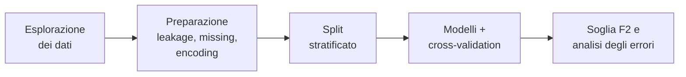

# Previsione delle riammissioni ospedaliere in pazienti diabetici

Progetto del corso di **Machine Learning** — Laurea in Informatica, Università degli Studi di Salerno, A.A. 2025/26
(prof. Giuseppe Polese, prof.ssa Loredana Caruccio).

**Autori:** Dario Juri Pepe · Alessandro Liguori

---

## Il problema

Una riammissione in ospedale **entro 30 giorni** dalla dimissione è un segnale di cure non adeguate e un costo per il sistema sanitario.
Il progetto costruisce un modello di **classificazione binaria** che, al momento della dimissione, stima se un paziente diabetico verrà riammesso entro 30 giorni, così da indirizzare i pazienti più a rischio verso un follow-up mirato.

Poiché perdere un paziente a rischio costa più di un falso allarme, la valutazione privilegia la **recall**.

## Il dataset

[Diabetes 130-US Hospitals for Years 1999–2008](https://archive.ics.uci.edu/dataset/296/diabetes-130-us-hospitals-for-years-1999-2008) (UCI Machine Learning Repository), descritto in Strack et al. (2014).

- 101.766 ricoveri di 71.518 pazienti diabetici, in 130 ospedali statunitensi
- 50 variabili: dati demografici, ricovero e dimissione, diagnosi ICD-9, esami, farmaci
- Classi fortemente sbilanciate: solo l'11% dei ricoveri è una riammissione entro 30 giorni

Il dataset viene scaricato direttamente dal notebook: non serve scaricarlo a mano.

## La pipeline

Gli aspetti principali affrontati:

- **Data leakage**: un solo ricovero per paziente, così lo stesso paziente non finisce sia nel train sia nel test
- **Valori mancanti**: trattati come informazione quando il dato mancante ha un significato (esame non eseguito)
- **Sbilanciamento delle classi**: metriche adatte (precision, recall, F1, PR-AUC), pesi delle classi e confronto con SMOTE
- **Selezione dei modelli**: baseline, Decision Tree, Logistic Regression e Random Forest, con iperparametri scelti in cross-validation
- **Interpretazione**: importanza delle feature, coefficienti e analisi dei tipi di errore

## Risultati

| Modello | Recall | Precision | ROC-AUC | PR-AUC |
| --- | --- | --- | --- | --- |
| Baseline (classe più frequente) | 0,00 | — | 0,50 | 0,09 |
| **Random Forest + soglia ottimizzata** | **0,72** | **0,12** | **0,65** | **0,18** |

Il modello finale riconosce circa il **72% dei pazienti riammessi**. Le prestazioni restano modeste: l'analisi degli errori mostra che molti pazienti riammessi sono indistinguibili dagli altri con le variabili disponibili, quindi il limite principale è nei dati più che nel modello.
Tutti i dettagli sono nella relazione.

## Contenuto del repository

| File | Descrizione |
| --- | --- |
| `ProgettoML.ipynb` | Notebook con tutto il codice, commentato cella per cella |
| `Relazione.pdf` | Relazione del progetto |
| `Presentazione.pdf` | Slide per la discussione |

## Come eseguirlo

1. Apri il notebook in [Google Colab](https://colab.research.google.com/) (**File → Apri notebook → GitHub** e incolla il link di questo repository).
2. Esegui **Runtime → Esegui tutte**. L'esecuzione completa richiede circa 10–15 minuti.

Librerie usate: `pandas`, `numpy`, `matplotlib`, `seaborn`, `scikit-learn`, `imbalanced-learn`, `ucimlrepo` (quest'ultima viene installata dal notebook).

## Uso dell'intelligenza artificiale

Durante lo sviluppo abbiamo usato Claude (Anthropic) come supporto, come dichiarato nella relazione. Le scelte progettuali e i risultati sono stati verificati e discussi dagli autori.

## Riferimenti

- Strack, B. et al. (2014). *Impact of HbA1c Measurement on Hospital Readmission Rates: Analysis of 70,000 Clinical Database Patient Records.* BioMed Research International, 2014, 781670.
- Chawla, N. V. et al. (2002). *SMOTE: Synthetic Minority Over-sampling Technique.* Journal of Artificial Intelligence Research, 16, 321–357.
- Pedregosa, F. et al. (2011). *Scikit-learn: Machine Learning in Python.* Journal of Machine Learning Research, 12, 2825–2830.
